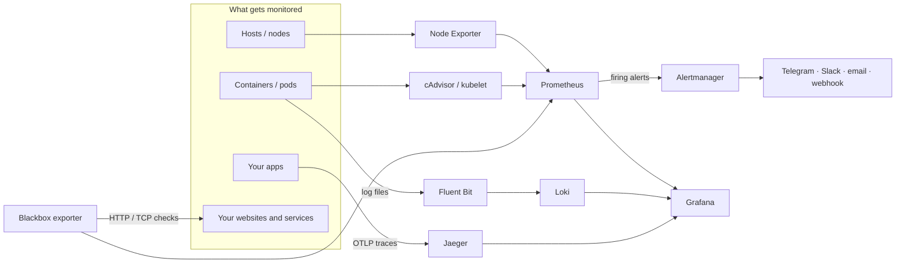

# Infra Monitor

[](https://github.com/OcheOps/Infra-Monitor/actions/workflows/ci.yml)
[](https://github.com/OcheOps/Infra-Monitor/releases)
[](LICENSE)

**Metrics, logs, traces, dashboards and alerts for your servers or Kubernetes
cluster, set up by answering a few questions.**

Infra Monitor packages a standard open-source observability stack, ready
configured, as one interactive CLI. It runs the same stack on a Linux host with
Docker Compose or on any Kubernetes cluster. Tell it which websites to check and
where to send alerts; it writes every config file for you.

```text
$ infra-monitor
Welcome to Infra Monitor! Let's set things up.

[1/5] Grafana admin password
Generate a random password? [Y/n]:

[2/5] Websites and services to check
URL to check (blank to finish): https://shop.example.com
URL to check (blank to finish): tcp://db.internal:5432
URL to check (blank to finish):
...
Start the stack now?
  1) Docker Compose on this host
  2) Kubernetes (prod-cluster)
  3) Not now
```

## Contents

- [What you get](#what-you-get)
- [How it fits together](#how-it-fits-together)
- [Install](#install)
- [Quick start](#quick-start)
- [Everyday commands](#everyday-commands)
- [Checking websites and services](#checking-websites-and-services)
- [Alerts and notifications](#alerts-and-notifications)
- [Running on a single host](#running-on-a-single-host-docker-compose)
- [Running on Kubernetes](#running-on-kubernetes)
- [Sending your own data](#sending-your-own-data)
- [Your own rules and dashboards](#your-own-rules-and-dashboards)
- [Configuration file](#configuration-file)
- [Data and retention](#data-and-retention)
- [Troubleshooting](#troubleshooting)
- [Development](#development)
- [Limitations](#limitations)

## What you get

| Signal            | Component                                   | What it does |
|-------------------|---------------------------------------------|--------------|
| Uptime checks     | Blackbox exporter                           | checks your URLs and TCP services every 15 seconds |
| Host metrics      | Node Exporter                               | CPU, memory, disk, network for every host or node |
| Container metrics | cAdvisor (Compose), kubelet (Kubernetes)    | per-container CPU, memory and network |
| Cluster state     | kube-state-metrics (Kubernetes)             | Deployments, pods, restarts, jobs, nodes |
| Metrics storage   | Prometheus                                  | scrapes everything above and evaluates the alert rules |
| Logs              | Fluent Bit → Loki                           | host and container logs, tagged with pod metadata on Kubernetes |
| Traces            | Jaeger v2                                   | receives OpenTelemetry (OTLP) traces from your apps |
| Dashboards        | Grafana                                     | Node Exporter and cAdvisor dashboards; Prometheus, Loki and Jaeger datasources |
| Notifications     | Alertmanager                                | Telegram, Slack, email and webhooks |

Every image version is pinned, so an install today gives you the same stack as
an install next month.

## How it fits together



## Install

```bash
curl -fsSL https://raw.githubusercontent.com/OcheOps/Infra-Monitor/main/install.sh | sh
```

The installer detects your OS and CPU, downloads the matching release,
verifies its checksum and installs `infra-monitor`:
- **Where it goes:** `/usr/local/bin`, using sudo if needed. If sudo isn't
  available, it falls back to `~/.local/bin`.
- **Upgrading:** run the same command again.
- **Pinning a version:** prefix it with `INFRA_MONITOR_VERSION=v0.1.0`.
- **Choosing the folder:** prefix it with `INFRA_MONITOR_INSTALL_DIR=~/bin`.

Prefer not to pipe a script into your shell? Download it first and read it:
`curl -fsSLO https://raw.githubusercontent.com/OcheOps/Infra-Monitor/main/install.sh && less install.sh && sh install.sh`.

<details>
<summary><b>Other ways to install</b></summary>

From the [Releases page](https://github.com/OcheOps/Infra-Monitor/releases):

| Platform | Install |
|----------|---------|
| Debian / Ubuntu | `sudo apt install ./infra-monitor_<version>_amd64.deb` |
| Fedora / RHEL / Rocky | `sudo dnf install ./infra-monitor-<version>-1.x86_64.rpm` |
| Any Linux or macOS | unpack `infra-monitor_<version>_<os>_<arch>.tar.gz` and put `infra-monitor` on your `PATH` |
| With Go | `go install github.com/OcheOps/Infra-Monitor/cmd/infra-monitor@latest` |
| From source | `make install` (installs to `/usr/local/bin`; needs Go 1.22+) |

The `.deb` and `.rpm` packages also install tab completion for bash, zsh and
fish. Builds are published for Linux and macOS on amd64 and arm64, with a
`checksums.txt` to verify downloads.

</details>

### Check your machine

```bash
infra-monitor doctor
```

`doctor` checks everything the stack needs and tells you how to fix whatever is
missing:
- **Docker Compose:** that Docker and the Compose plugin are installed, that
  the Docker daemon is running and you're allowed to use it, and that the
  stack's ports are free.
- **Kubernetes:** that kubectl is installed, the cluster is reachable, you
  have the permissions the stack needs, and there's a default StorageClass.

`compose up` and `k8s apply` run the same checks first, so a missing
prerequisite stops them with the fix instead of a confusing error halfway
through.

You need one of:
- **Docker** with the Compose plugin, on Linux.
- **`kubectl`** with access to a Kubernetes cluster (1.25+).

### Tab completion

Packages install it automatically. Otherwise:

```bash
infra-monitor completion bash | sudo tee /etc/bash_completion.d/infra-monitor   # bash
infra-monitor completion zsh  > "${fpath[1]}/_infra-monitor"                    # zsh
infra-monitor completion fish > ~/.config/fish/completions/infra-monitor.fish   # fish
```

### Uninstall

Remove the binary: `sudo rm /usr/local/bin/infra-monitor` (or
`~/.local/bin/infra-monitor`), or `sudo apt remove infra-monitor` /
`sudo dnf remove infra-monitor` for packages.

This doesn't touch your config or data. Stop the stack first with
`infra-monitor compose down` or `infra-monitor k8s delete`, then delete
`~/.infra-monitor` if you no longer want your settings.

## Quick start

```bash
infra-monitor
```

With no arguments, `infra-monitor` starts the setup wizard the first time, then
shows a menu every time after that. At the end of setup, pick where to run it.
Then open Grafana:

- **On this host:** http://localhost:3000
- **On Kubernetes:** run `infra-monitor k8s port-forward grafana`, then open
  http://localhost:3000

Sign in as `admin` with the password the wizard showed you. It's also in
`~/.infra-monitor/config.yaml`.

Prefer to script it? Every question has a flag:

```bash
infra-monitor init --probe https://example.com --telegram-token 123:ABC --telegram-chat-id 42
infra-monitor compose up        # or: infra-monitor k8s apply
```

## Everyday commands

| Task | Command |
|------|---------|
| Interactive menu | `infra-monitor` |
| Run the setup wizard again | `infra-monitor init` |
| Check a new website | `infra-monitor probes add https://example.com` |
| Stop checking it | `infra-monitor probes remove https://example.com` (or no argument to pick from a list) |
| List what's checked | `infra-monitor probes list` |
| Scrape another metrics endpoint | `infra-monitor targets add web-2 10.0.0.6:9100` |
| Set up alert channels | `infra-monitor notify setup` |
| Send a test alert | `infra-monitor notify test` |
| Check prerequisites | `infra-monitor doctor` |
| See your settings (secrets hidden) | `infra-monitor config show` |
| Apply changes on this host | `infra-monitor compose up` |
| Apply changes on Kubernetes | `infra-monitor k8s apply` |

Commands that change settings offer to apply the change right away when run in
a terminal. In scripts they print what to run instead. Run any command with
`--help` to see its flags.

## Checking websites and services

```bash
infra-monitor probes add https://shop.example.com https://api.example.com/health
infra-monitor probes add tcp://db.internal:5432     # TCP: is the port accepting connections?
```

- **`http://` and `https://` URLs** must answer with a 2xx status. Redirects
  are followed.
- **`tcp://host:port`** only checks that the port accepts connections. Use it
  for databases, mail servers and other non-HTTP services.

Every check alerts you when it fails for 2 minutes, when it's slow (over 5
seconds on average), and when its TLS certificate expires within 14 days.

## Alerts and notifications

### Channels

Set them up interactively with `infra-monitor notify setup`, or with flags:

```bash
infra-monitor notify add telegram --token 123456:ABC-xyz --chat-id 987654321
infra-monitor notify add slack    --webhook-url https://hooks.slack.com/services/... --channel '#alerts'
infra-monitor notify add email    --to ops@example.com --from monitor@example.com \
                                  --smarthost smtp.gmail.com:587 --username monitor@example.com --password '...'
infra-monitor notify add webhook  --url https://example.com/alert-hook
infra-monitor notify remove slack
infra-monitor notify test         # sends a test alert through every channel
```

You can use any combination of channels; each alert goes to all of them. Each
channel also gets a message when the alert resolves. With no channels, alerts
still show in Prometheus and Alertmanager.

<details>
<summary><b>Getting a Telegram bot token and chat ID</b></summary>

1. Message [@BotFather](https://t.me/BotFather), send `/newbot` and follow the
   prompts. It replies with the token.
2. Send any message to your new bot, or add it to a group and post there.
3. Open `https://api.telegram.org/bot<TOKEN>/getUpdates` in a browser. The
   `chat.id` value is your chat ID; group IDs are negative numbers.

</details>

<details>
<summary><b>Gmail and other SMTP providers</b></summary>

Use `smtp.gmail.com:587` with your address as the username and an
[app password](https://support.google.com/accounts/answer/185833) (not your
normal password). Other providers work the same way with their own SMTP host
and port.

</details>

`notify test` talks to Alertmanager on `localhost:9093`. On Kubernetes, run
`infra-monitor k8s port-forward alertmanager` in another terminal first.

### Built-in alerts

| Alert | Fires when | For |
|-------|-----------|-----|
| `InstanceDown` | a scrape target stops responding | 1 min |
| `TargetFlapping` | a target goes up and down more than 4 times in 15 min | — |
| `ProbeFailed` | a website or service check fails | 2 min |
| `ProbeSlow` | a check takes over 5 s on average | 5 min |
| `TLSCertificateExpiringSoon` | a certificate expires within 14 days | 1 h |
| `HostOutOfDiskSpace` | a filesystem has under 10% free | 5 min |
| `HostDiskWillFillIn24Hours` | a filesystem will fill up within a day at the current rate | 30 min |
| `HostOutOfMemory` | under 10% memory available | 5 min |
| `HostHighCpuLoad` | CPU above 90% | 10 min |
| `HostClockSkew` | the clock is off by more than 50 ms | 10 min |

On Kubernetes you also get:

| Alert | Fires when | For |
|-------|-----------|-----|
| `KubePodCrashLooping` | a container is in CrashLoopBackOff | 10 min |
| `KubePodNotReady` | a pod is Pending, Unknown or Failed | 15 min |
| `KubeContainerOOMKilled` | a container was killed for using too much memory | — |
| `KubeDeploymentReplicasMismatch` | a Deployment is short of replicas | 15 min |
| `KubeStatefulSetReplicasMismatch` | a StatefulSet is short of replicas | 15 min |
| `KubeDaemonSetNotScheduled` | a DaemonSet is missing pods on some nodes | 15 min |
| `KubeJobFailed` | a Job failed | — |
| `KubeNodeNotReady` | a node is not ready | 5 min |
| `KubePersistentVolumeFillingUp` | a volume has under 10% free | 5 min |

To add your own, see [Your own rules and dashboards](#your-own-rules-and-dashboards).

## Running on a single host (Docker Compose)

```bash
infra-monitor compose up              # write the project and start it (re-run after any change)
infra-monitor compose status          # container status
infra-monitor compose logs [SERVICE]  # follow logs, e.g. `compose logs grafana`
infra-monitor compose restart         # restart everything
infra-monitor compose down            # stop; data is kept
infra-monitor compose sync            # write the project files without starting anything
```

The project is written to `~/.infra-monitor/compose` and runs under the Compose
project name `infra-monitor`. Every port is bound to `127.0.0.1`, so nothing is
reachable from other machines by default:

| Service      | URL                    |
|--------------|------------------------|
| Grafana      | http://localhost:3000  |
| Prometheus   | http://localhost:9090  |
| Alertmanager | http://localhost:9093  |
| Jaeger UI    | http://localhost:16686 |
| Loki         | http://localhost:3100  |
| cAdvisor     | http://localhost:8080  |

To reach Grafana from another machine, use an SSH tunnel
(`ssh -L 3000:localhost:3000 your-server`) or a reverse proxy with TLS.

## Running on Kubernetes

```bash
infra-monitor k8s configure           # namespace, storage, ingress (guided, or use flags)
infra-monitor k8s apply               # deploy or update
infra-monitor k8s status              # pods, services, volumes, ingress
infra-monitor k8s port-forward grafana [PORT]   # also: prometheus, alertmanager, jaeger, loki
infra-monitor k8s render > stack.yaml # print the manifests instead of applying them
infra-monitor k8s delete              # remove the stack, keep the data volumes
infra-monitor k8s delete --purge      # also delete the namespace and all data
```

`apply`, `render`, `status` and `delete` accept `-n NAMESPACE` and
`--context CONTEXT` to override the saved settings for one run.

### Settings

`k8s configure` asks for these, or takes them as flags:

| Setting | Flag | Default |
|---------|------|---------|
| Namespace | `--namespace` | `infra-monitor` |
| kubectl context | `--context` | current context |
| StorageClass | `--storage-class` | cluster default |
| Volume sizes | `--prometheus-storage`, `--loki-storage`, `--jaeger-storage`, `--grafana-storage` | 10Gi, 10Gi, 5Gi, 1Gi |
| Grafana hostname | `--ingress-host` | none (no Ingress) |
| IngressClass | `--ingress-class` | cluster default |
| TLS certificate | `--cluster-issuer` (cert-manager) or `--tls-secret` (existing Secret) | none |

For example, to put Grafana at `https://grafana.example.com` with a Let's
Encrypt certificate from [cert-manager](https://cert-manager.io):

```bash
infra-monitor k8s configure --ingress-host grafana.example.com --ingress-class nginx --cluster-issuer letsencrypt-prod
infra-monitor k8s apply
```

### What gets deployed

| Component          | Kind        | Memory (request / limit) | Notes |
|--------------------|-------------|--------------------------|-------|
| Prometheus         | StatefulSet | 512Mi / 2Gi | finds targets through the Kubernetes API |
| Grafana            | StatefulSet | 128Mi / 512Mi | admin password in a Secret; optional Ingress |
| Loki               | StatefulSet | 256Mi / 1Gi | single-binary mode |
| Jaeger             | StatefulSet | 128Mi / 1Gi | v2, Badger storage |
| Alertmanager       | Deployment  | 32Mi / 128Mi | config, including channel secrets, in a Secret |
| kube-state-metrics | Deployment  | 64Mi / 256Mi | read-only access to cluster objects |
| Blackbox exporter  | Deployment  | 32Mi / 64Mi | |
| Node Exporter      | DaemonSet   | 32Mi / 128Mi | every node, including control-plane; host port 9100 |
| Fluent Bit         | DaemonSet   | 64Mi / 256Mi | every node; tags logs with namespace, pod and container |

There are no CPU limits on purpose, so busy components get slowed down
(throttled) rather than restarted.

Running `apply` again after a change updates the stack in place and restarts
only the pods whose configuration changed. The cluster-wide RBAC objects are
named after the namespace, so you can install more than one copy in a cluster.

> **`render` output contains your secrets** (channel credentials and the
> Grafana password). If you feed it to a GitOps tool, encrypt it first, for
> example with [Sealed Secrets](https://github.com/bitnami-labs/sealed-secrets)
> or [SOPS](https://github.com/getsops/sops).

## Sending your own data

### Traces

Point any OpenTelemetry SDK or Collector at Jaeger:

| From | OTLP gRPC | OTLP HTTP |
|------|-----------|-----------|
| The Compose host | `localhost:4317` | `http://localhost:4318` |
| Inside the cluster | `jaeger.infra-monitor.svc:4317` | `http://jaeger.infra-monitor.svc:4318` |

```bash
export OTEL_EXPORTER_OTLP_ENDPOINT=http://localhost:4318
export OTEL_SERVICE_NAME=my-app
```

Find traces in Grafana (Explore → Jaeger) or the Jaeger UI. The old Jaeger
Thrift endpoint (port 14268) still works for older clients.

### Metrics

- **Any host:** `infra-monitor targets add NAME HOST:PORT [--path /metrics]`.
  For example, scrape another server's Node Exporter with
  `targets add db-1 10.0.0.7:9100`.
- **Kubernetes pods:** annotate them and they're found automatically:

  ```yaml
  metadata:
    annotations:
      prometheus.io/scrape: "true"
      prometheus.io/port: "8080"       # optional; without it, every declared container port is scraped
      prometheus.io/path: "/metrics"   # optional
  ```

### Logs

Nothing to set up. On a Compose host, Fluent Bit ships `/var/log/syslog`,
`/var/log/messages` and every Docker container's output. On Kubernetes, it
ships every pod's output. In Grafana, open Explore → Loki and filter by
`job="container-logs"` (Compose) or `job="kubernetes"` (Kubernetes).

## Your own rules and dashboards

Drop files into these folders. They're picked up the next time you run
`compose up` or `k8s apply`, and nothing needs rebuilding:

| Folder | What goes in it |
|--------|-----------------|
| `~/.infra-monitor/rules/` | Prometheus alert rule files (`*.yml`) |
| `~/.infra-monitor/dashboards/` | Grafana dashboard JSON exports (`*.json`, up to 900 KiB each) |

A rule file looks like this:

```yaml
groups:
  - name: my-app
    rules:
      - alert: CheckoutErrors
        expr: rate(http_requests_total{job="shop", code=~"5.."}[5m]) > 1
        for: 5m
        labels:
          severity: critical
        annotations:
          summary: "Checkout is returning errors"
```

Files are checked before deploying: a malformed one stops the deploy with a
message naming the file. Delete a file and it's removed from the stack on the
next apply. To test a rule properly, run it through
[`promtool check rules`](https://prometheus.io/docs/prometheus/latest/command-line/promtool/).

Dashboards you build in the Grafana UI are saved in Grafana's own storage and
survive restarts. Export them to the dashboards folder to keep them under your
control.

## Configuration file

Everything lives in `~/.infra-monitor/config.yaml`, which only you can read.
The commands above edit it for you, but you can edit it by hand too: it's
checked on the next command, and typos in field names are reported.

```yaml
grafana:
  admin_password: ...
probes:
  - https://shop.example.com
  - tcp://db.internal:5432
targets:
  - name: db-1
    address: 10.0.0.7:9100
notifications:
  telegram:
    bot_token: ...
    chat_id: "987654321"
  slack:
    webhook_url: https://hooks.slack.com/services/...
    channel: '#alerts'
retention:
  metrics: 15d
  logs: 30d
  traces: 3d
kubernetes:
  namespace: infra-monitor
  storage:
    prometheus: 10Gi
    loki: 10Gi
    jaeger: 5Gi
    grafana: 1Gi
  ingress:
    host: grafana.example.com
    cluster_issuer: letsencrypt-prod
```

To keep config somewhere else, pass `--dir DIR` to any command or set
`INFRA_MONITOR_DIR`.

Upgrading from a version that used `~/.infra-monitor/.env`? It's imported
automatically the first time you run a command, and the old file is renamed to
`.env.migrated`.

> **Note:** Grafana only reads the admin password on its first start. To change
> it later, use Grafana's UI or `grafana cli admin reset-admin-password`.

## Data and retention

Set retention in the wizard, with `init --retention-metrics / --retention-logs
/ --retention-traces`, or in `config.yaml`. Values are a number followed by
`h`, `d` or `w`, with a minimum of 24h.

| Store | Default | Compose volume | Kubernetes volume |
|-------|---------|----------------|-------------------|
| Prometheus (metrics) | 15 days | `infra-monitor_prometheus-data` | `data-prometheus-0` |
| Loki (logs) | 30 days | `infra-monitor_loki-data` | `data-loki-0` |
| Jaeger (traces) | 3 days | `infra-monitor_jaeger-data` | `data-jaeger-0` |
| Grafana (users, settings, saved dashboards) | kept | `infra-monitor_grafana-data` | `data-grafana-0` |

`compose down` and `k8s delete` keep all data. To delete it too, run
`docker compose -p infra-monitor down -v` or `infra-monitor k8s delete --purge`.

## Troubleshooting

**`config not found ... run infra-monitor init first`**
Run `infra-monitor` or `infra-monitor init`. If you used `--dir` or
`INFRA_MONITOR_DIR` before, use the same one again.

**A setting is rejected.**
The message names the field and the expected format, for example "telegram
chat id must be a number". Fix it in the wizard, with the matching command, or
in `config.yaml`.

**Grafana won't accept the password.**
The password only applies on Grafana's first start. If you changed it
afterwards, reset it inside Grafana, or delete the Grafana volume to start
fresh.

**No alert messages arrive.**
Run `infra-monitor notify test`. If it fails, the stack isn't running or (on
Kubernetes) the port-forward isn't open. If it succeeds but nothing arrives,
open http://localhost:9093 for send errors. Then check the channel settings:
for Telegram, has the bot been added to the chat, and is the chat ID right
(group IDs are negative)? For email, did you use an app password?

**A target or check shows as DOWN.**
Open http://localhost:9090/targets (Compose) or
`infra-monitor k8s port-forward prometheus` and read the error next to it.

**Node Exporter pods stay Pending or crash-loop on Kubernetes.**
Something on the node already uses port 9100, often another monitoring stack's
node exporter. Remove one of them.

**cAdvisor fails to start on Docker Desktop.**
cAdvisor needs host mounts that Docker Desktop on macOS and Windows doesn't
provide. Run the Compose stack on a Linux host.

## Development

```
cmd/infra-monitor/   entrypoint
internal/cli/        commands, wizard, menus and shell completion
internal/doctor/     prerequisite checks for Docker and Kubernetes
internal/prompt/     terminal prompts (hidden input for secrets)
internal/config/     config.yaml: loading, validation, saving, .env migration
internal/stack/      renders Prometheus, Alertmanager, Loki and Jaeger configs; rules; dashboards
internal/compose/    writes the Compose project, runs `docker compose`
internal/k8s/        renders the manifest templates, runs `kubectl`
deploy/compose/      docker-compose.yml (the single list of pinned image versions)
deploy/k8s/          manifest templates and Kubernetes-only rules
deploy/shared/       config templates, alert rules and Grafana provisioning for both backends
```

Everything under `deploy/` is built into the binary.

```bash
make test       # go vet + unit tests
make build      # bin/infra-monitor
make snapshot   # every release artifact into dist/, without publishing (needs goreleaser)
```

**CI** ([workflow](.github/workflows/ci.yml)) runs on every pull request:

- **Unit tests**, including scripted runs of the interactive wizard and menu.
- **Packaging:** shellcheck on every script; installs the `.deb`; runs
  `install.sh` against the built release, including a tampered checksum
  that must be rejected.
- **Official config checkers** on configs that use every feature:
  `promtool`, `amtool`, `docker compose config` and a strict `kubeconform`.
- **A Compose smoke test:** starts the stack and checks scrape targets, a
  working probe, Loki readiness, a trace round-trip through Jaeger, and
  `notify test`.
- **A Kubernetes smoke test** on a [kind](https://kind.sigs.k8s.io) cluster:
  checks every rollout, all scrape targets, kube-state-metrics data, logs in
  Loki, and that re-applying a change rolls Prometheus.

**Releases:** open Actions → Release → Run workflow and enter a version like
`v0.2.0`, or push that tag yourself. Either way, [GoReleaser](.goreleaser.yaml)
publishes binaries, `.deb`/`.rpm` packages (with shell completion) and
checksums to GitHub Releases. **Dependabot** opens weekly PRs for Go modules, GitHub Actions and
the pinned images in `deploy/compose/docker-compose.yml`. Kubernetes reads its
image versions from that file too, so one PR updates both backends.

## Limitations

- **Single replica of everything.** Fine for a host or a small-to-medium
  cluster, but not highly available.
- **One Compose host per stack.** To watch other machines from one stack, run
  Node Exporter on them and add them with `targets add`.
- **No authentication in front of Prometheus, Alertmanager, Loki or Jaeger.**
  They're only reachable on `localhost` or inside the cluster; keep it that way,
  or put an authenticating proxy in front.

## License

[MIT](LICENSE) · Built for DevOps by Oche
