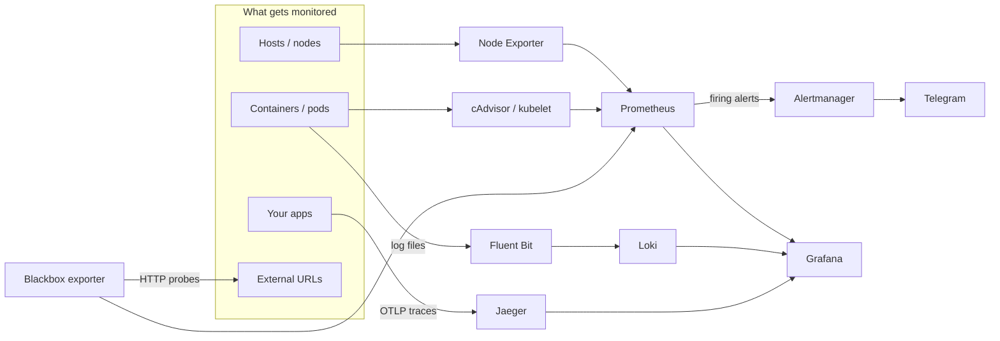

# Infra Monitor

[](https://github.com/OcheOps/Infra-Monitor/actions/workflows/ci.yml)
[](LICENSE)

**Metrics, logs, traces, dashboards and alerts for your servers or Kubernetes
cluster, from one binary and one command.**

Infra Monitor packages a standard open-source observability stack, ready
configured, as a single CLI. It runs the same stack on one Linux host with
Docker Compose or on any Kubernetes cluster. There is nothing to write first:
the configs, alert rules and Grafana dashboards are built into the binary.

```bash
infra-monitor init
infra-monitor compose up          # or: infra-monitor k8s apply
```

## Contents

- [What you get](#what-you-get)
- [How it fits together](#how-it-fits-together)
- [Quick start](#quick-start)
- [Install](#install)
- [Configuration](#configuration)
- [Running on a single host](#running-on-a-single-host-docker-compose)
- [Running on Kubernetes](#running-on-kubernetes)
- [Sending your own data](#sending-your-own-data)
- [Alerts](#alerts)
- [Data and retention](#data-and-retention)
- [Customising the stack](#customising-the-stack)
- [Troubleshooting](#troubleshooting)
- [Development](#development)
- [Limitations](#limitations)

## What you get

| Signal            | Component                              | What it does |
|-------------------|----------------------------------------|--------------|
| Host metrics      | Node Exporter                          | CPU, memory, disk, network for every host or node |
| Container metrics | cAdvisor (Compose), kubelet (Kubernetes) | per-container CPU, memory and network |
| Uptime checks     | Blackbox exporter                      | HTTP probes of URLs you choose |
| Metrics storage   | Prometheus                             | scrapes everything above, evaluates alert rules |
| Logs              | Fluent Bit → Loki                      | collects host and container logs (with pod metadata on Kubernetes) |
| Traces            | Jaeger                                 | receives OpenTelemetry (OTLP) traces from your apps |
| Dashboards        | Grafana                                | ready-made Node Exporter and cAdvisor dashboards; Prometheus, Loki and Jaeger datasources |
| Notifications     | Alertmanager → Telegram                | sends firing alerts to a Telegram chat (optional) |

Every image version is pinned, so an install today gives you the same stack as
an install next month.

## How it fits together



## Quick start

**On one host**, with Docker installed:

```bash
make build
./bin/infra-monitor init          # prints the Grafana admin password once
./bin/infra-monitor compose up
```

Open http://localhost:3000, sign in as `admin` with the printed password, and
open the **Infra Monitor** dashboard folder.

**On Kubernetes**, with `kubectl` pointed at your cluster:

```bash
./bin/infra-monitor init
./bin/infra-monitor k8s apply
./bin/infra-monitor k8s port-forward grafana    # then open http://localhost:3000
```

## Install

| Method | Command | Notes |
|--------|---------|-------|
| From source | `make build` | binary at `bin/infra-monitor` |
| System package | `make install` | builds a `.deb` (Debian/Ubuntu) or `.rpm` (Fedora/RHEL family, needs [`fpm`](https://fpm.readthedocs.io)); other distros get a copy in `/usr/local/bin` |
| Go toolchain | `go install github.com/OcheOps/Infra-Monitor/cmd/infra-monitor@latest` | |

**Build requirements:** Go 1.22 or later.

**Runtime requirements** (only the one you use):

- **Compose:** Docker with the Compose plugin (`docker compose version` works), on Linux.
- **Kubernetes:** `kubectl` with access to a cluster (1.25+) that has a default
  StorageClass, or one you pass with `--storage-class`.

## Configuration

`init` creates the config file. Run it again at any time to change a value;
settings you don't pass are kept.

```bash
infra-monitor init \
  --telegram-token 123456:ABC-xyz \
  --telegram-chat-id 987654321
```

| Flag | Meaning |
|------|---------|
| `--telegram-token` | bot token from [@BotFather](https://t.me/BotFather) |
| `--telegram-chat-id` | chat or group that receives alerts |
| `--grafana-password` | Grafana admin password; a random one is generated if you don't set one |
| `--no-telegram` | clear the Telegram settings and run without notifications |

The config is stored in `~/.infra-monitor/.env`, readable only by you. It holds
secrets, so don't commit or share it. Environment variables with the same names
(`TELEGRAM_API_KEY`, `TELEGRAM_CHAT_ID`, `GRAFANA_ADMIN_PASSWORD`) override the
file, which is handy in CI.

To keep config elsewhere, pass `--dir DIR` to any command or set
`INFRA_MONITOR_DIR`.

<details>
<summary><b>Getting a Telegram bot token and chat ID</b></summary>

1. Message [@BotFather](https://t.me/BotFather), send `/newbot` and follow the
   prompts. It replies with the token.
2. Send any message to your new bot, or add it to a group and post there.
3. Open `https://api.telegram.org/bot<TOKEN>/getUpdates` in a browser. The
   `chat.id` value is your chat ID; group IDs are negative numbers.

</details>

> **Note:** Grafana only reads the admin password on its first start. To change
> it later, use Grafana's UI or `grafana cli admin reset-admin-password`.

## Running on a single host (Docker Compose)

```bash
infra-monitor compose up              # write the project and start it (re-run to apply config changes)
infra-monitor compose status          # container status
infra-monitor compose logs [SERVICE]  # follow logs, e.g. `compose logs grafana`
infra-monitor compose restart         # restart everything after `init` changes
infra-monitor compose down            # stop; data volumes are kept
```

`compose up` writes the Compose project to `~/.infra-monitor/compose` and
starts it under the project name `infra-monitor`.

Every port is bound to `127.0.0.1`, so nothing is reachable from other machines
by default:

| Service      | URL                    |
|--------------|------------------------|
| Grafana      | http://localhost:3000  |
| Prometheus   | http://localhost:9090  |
| Alertmanager | http://localhost:9093  |
| Jaeger UI    | http://localhost:16686 |
| Loki         | http://localhost:3100  |
| cAdvisor     | http://localhost:8080  |

To view the dashboards from another machine, use an SSH tunnel
(`ssh -L 3000:localhost:3000 your-server`) or put a reverse proxy with TLS in
front of Grafana.

## Running on Kubernetes

```bash
infra-monitor k8s apply                         # current context, namespace "infra-monitor"
infra-monitor k8s apply -n monitoring --context prod --storage-class gp3
infra-monitor k8s status                        # pods, services and volumes
infra-monitor k8s port-forward grafana [PORT]   # also: prometheus, alertmanager, jaeger, loki
infra-monitor k8s render > stack.yaml           # print the manifests instead of applying them
infra-monitor k8s delete                        # remove the stack, keep the data volumes
infra-monitor k8s delete --purge                # also delete the namespace and all data
```

The flags `-n/--namespace` and `--context` work on every `k8s` command.

**What gets deployed:**

| Component     | Kind        | Storage | Notes |
|---------------|-------------|---------|-------|
| Prometheus    | StatefulSet | 10Gi    | finds targets through the Kubernetes API |
| Grafana       | StatefulSet | 1Gi     | admin password in a Secret |
| Loki          | StatefulSet | 10Gi    | single-binary mode |
| Jaeger        | StatefulSet | 5Gi     | Badger storage |
| Alertmanager  | Deployment  |         | config, including the bot token, in a Secret |
| Blackbox      | Deployment  |         | |
| Node Exporter | DaemonSet   |         | on every node, including control-plane nodes; uses host port 9100 |
| Fluent Bit    | DaemonSet   |         | on every node; tags logs with namespace, pod and container |

Running `apply` again after a config change updates the stack in place and
restarts only the pods whose config changed. The cluster-wide RBAC objects are
named after the namespace, so you can install more than one copy in a cluster.

> **`render` output contains your secrets** (bot token and Grafana password).
> If you feed it to a GitOps tool, encrypt it first, for example with
> [Sealed Secrets](https://github.com/bitnami-labs/sealed-secrets) or
> [SOPS](https://github.com/getsops/sops).

## Sending your own data

### Traces

Point any OpenTelemetry SDK or Collector at Jaeger:

| From | OTLP gRPC | OTLP HTTP |
|------|-----------|-----------|
| The Compose host | `localhost:4317` | `http://localhost:4318` |
| Inside the cluster | `jaeger.infra-monitor.svc:4317` | `http://jaeger.infra-monitor.svc:4318` |

For example:

```bash
export OTEL_EXPORTER_OTLP_ENDPOINT=http://localhost:4318
export OTEL_SERVICE_NAME=my-app
```

Search for traces in Grafana (Explore → Jaeger) or in the Jaeger UI.

### Application metrics (Kubernetes)

Annotate your pods and Prometheus scrapes them automatically:

```yaml
metadata:
  annotations:
    prometheus.io/scrape: "true"
    prometheus.io/port: "8080"       # optional; without it, every declared container port is scraped
    prometheus.io/path: "/metrics"   # optional
```

On a Compose host, add a scrape job to the Prometheus config instead (see
[Customising the stack](#customising-the-stack)).

### Logs

Nothing to set up. On a Compose host, Fluent Bit ships `/var/log/syslog`,
`/var/log/messages` and every Docker container's output. On Kubernetes, it
ships every pod's output. In Grafana, open Explore → Loki and filter by
`job="container-logs"` (Compose) or `job="kubernetes"` (Kubernetes).

## Alerts

The built-in rules:

| Alert | Fires when | For |
|-------|-----------|-----|
| `InstanceDown` | a scrape target stops responding | 1 minute |
| `ProbeFailed` | a Blackbox HTTP check fails | 2 minutes |

With Telegram configured, Alertmanager sends each firing alert to your chat.
Without it, alerts still show in Prometheus (`/alerts`) and the Alertmanager UI.

To add rules, edit `deploy/shared/alerts/rules.yml` and rebuild. Both backends
use the same file.

## Data and retention

| Store | Default retention | Location (Compose) | Location (Kubernetes) |
|-------|-------------------|--------------------|-----------------------|
| Prometheus | 15 days | volume `infra-monitor_prometheus-data` | PVC `data-prometheus-0` |
| Loki | no limit (grows until the disk or volume is full) | volume `infra-monitor_loki-data` | PVC `data-loki-0` |
| Jaeger | 72 hours | volume `infra-monitor_jaeger-data` | PVC `data-jaeger-0` |
| Grafana | (settings, users, edits) | volume `infra-monitor_grafana-data` | PVC `data-grafana-0` |

`compose down` and `k8s delete` keep all data. To delete it too, run
`docker compose -p infra-monitor down -v` or `infra-monitor k8s delete --purge`.

## Customising the stack

Everything the CLI deploys lives in [`deploy/`](deploy) and is built into the
binary. To change anything, edit the file, run `make build`, then
`compose up` or `k8s apply` again.

| To change | Edit |
|-----------|------|
| Alert rules | `deploy/shared/alerts/rules.yml` |
| Telegram message format | `deploy/shared/alertmanager.yml.tmpl` |
| Grafana dashboards | add or replace JSON files in `deploy/shared/grafana/dashboards/` |
| URLs checked by Blackbox | the `blackbox` job in `deploy/compose/config/prometheus.yml` and `deploy/k8s/prometheus.yml` |
| Scrape jobs | the same two Prometheus files |
| Log collection | `deploy/compose/config/fluentbit.conf`, `deploy/k8s/fluent-bit.conf` |
| Image versions | `internal/stack/stack.go` **and** `deploy/compose/docker-compose.yml` (a test fails if they differ) |
| Kubernetes resources | the templates in `deploy/k8s/*.yaml` |

> Don't edit files under `~/.infra-monitor/compose`: `compose up` overwrites
> them from the binary.

## Troubleshooting

**`config not found ... run infra-monitor init first`**
Run `infra-monitor init`. If you used `--dir` or `INFRA_MONITOR_DIR` before,
use the same one again.

**Grafana won't accept the password.**
The password only applies on Grafana's first start. If you changed it with
`init` afterwards, reset it inside Grafana, or delete the Grafana volume to
start fresh.

**A target shows as DOWN in Prometheus.**
Open http://localhost:9090/targets (Compose) or
`infra-monitor k8s port-forward prometheus` and check the error next to the
target. `InstanceDown` alerts on this too.

**Node Exporter pods stay Pending or crash-loop on Kubernetes.**
Something on the node already uses port 9100, often another monitoring stack's
node exporter. Remove one of them.

**No Telegram messages arrive.**
Check http://localhost:9093 (or `k8s port-forward alertmanager`) for firing
alerts and send errors. Make sure the bot has been added to the chat and the
chat ID is right; group IDs are negative.

**cAdvisor fails to start on Docker Desktop.**
cAdvisor needs host mounts that Docker Desktop on macOS and Windows doesn't
provide. Run the Compose stack on a Linux host.

## Development

```
cmd/infra-monitor/   CLI entrypoint
internal/cli/        commands and flags
internal/config/     the .env file: loading, validation, saving
internal/stack/      pinned images, Alertmanager config rendering
internal/compose/    writes the Compose project, runs `docker compose`
internal/k8s/        renders manifest templates, runs `kubectl`
deploy/              everything embedded in the binary (see above)
```

```bash
make test       # go vet + unit tests
make build      # bin/infra-monitor
make deb        # Debian package
make rpm        # RPM package (needs fpm)
```

Every pull request runs [CI](.github/workflows/ci.yml):

- Unit tests and a strict schema check of the rendered manifests (`kubeconform`).
- A smoke test that starts the full Compose stack and waits for its scrape targets.
- A smoke test that deploys to a [kind](https://kind.sigs.k8s.io) cluster and
  checks that targets are up and logs reach Loki.

## Limitations

- **Single replica of everything.** Fine for a single host or a small cluster;
  not highly available.
- **No ingress or TLS.** Reach the UIs through `localhost`, SSH tunnels or
  `kubectl port-forward`, or add your own reverse proxy or Ingress.
- **No CPU or memory limits** on the Kubernetes workloads yet.
- **Loki keeps logs forever** unless you configure retention.
- **Jaeger runs v1 (`all-in-one:1.60`)**, which has reached end of life.
  Moving to Jaeger v2 is planned.

## License

[MIT](LICENSE) · Built for DevOps by Oche
